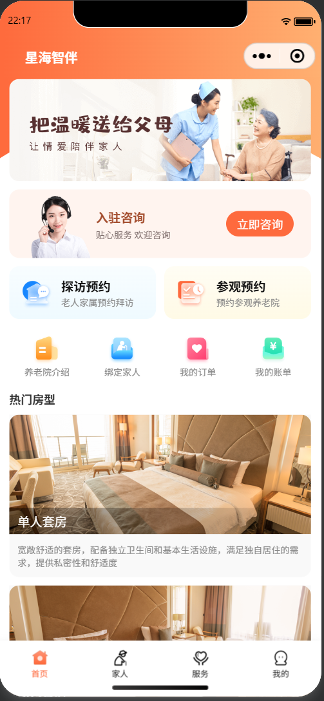
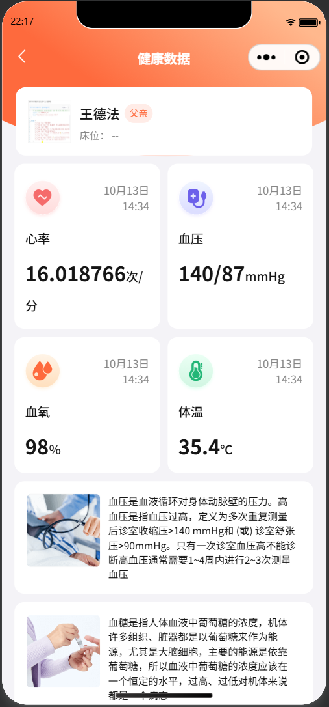

# 星海智伴 · 智慧养老护理平台

> 基于 RuoYi-Vue 3.9.0 + Spring Boot 3 + Vue 3 的养老院一体化管理平台（**管理后台 + 家属端微信小程序**），集成 Spring AI 大模型、华为云 IoT 设备接入、知识库 RAG、Dify 智能体等能力。

星海智伴为养老院量身定制，覆盖 **来访管理 → 入住办理 → 在住管理 → 服务管理 → 财务管理** 的完整业务链路，实现从来访参观到退住办理的全流程数字化；同时接入智能硬件与 AI 能力，让护理排班、健康评估、异常报警等工作从"人工记录"走向"数据驱动"。

---

## 运行界面预览

| 家属端小程序 · 首页 | 家属端小程序 · 健康数据 |
| --- | --- |
|  |  |

| 家属端小程序 · 下单服务 | 管理后台 |
| --- | --- |
|  |  |

---

## 目录

- [一、项目背景](#一项目背景)
- [二、系统架构](#二系统架构)
- [三、功能模块](#三功能模块)
- [四、技术栈](#四技术栈)
- [五、项目结构](#五项目结构)
- [六、数据库与脚本](#六数据库与脚本)
- [七、接口清单](#七接口清单)
- [八、定时任务](#八定时任务)
- [九、环境要求与快速开始](#九环境要求与快速开始)
- [十、配置说明](#十配置说明)
- [十一、AI 能力](#十一ai-能力)
- [十二、IoT 设备接入与报警](#十二iot-设备接入与报警)
- [十三、开发规范](#十三开发规范)
- [十四、开发笔记（notes/）](#十四开发笔记notes)
- [十五、常用命令](#十五常用命令)
- [十六、部署方案](#十六部署方案)
- [十七、说明与已知限制](#十七说明与已知限制)

---

## 一、项目背景

中国老龄化程度持续加深，智慧养老已成为养老服务体系发展的必然趋势。产业链正在从"人工看护"向"互联网 + 养老"的多元化服务模式整合。

星海智伴正是在这一背景下建设的养老院管理软件：一方面把院内日常运营流程标准化、线上化；另一方面用 AI 与 IoT 能力降低护理人员工作负担、提升照护质量。

## 二、系统架构

两端共用一套后端服务：

| 端 | 使用方 | 主要职责 |
| --- | --- | --- |
| 管理后台（`xhzb_ui`） | 养老院员工 | 来访 / 入住 / 在住 / 服务 / 任务排班 / 智能监测 / 财务报表 |
| 家属端小程序（`mp-weixin`） | 老人家属 | 登录绑定家人、健康数据、服务下单、订单 / 账单 / 合同、参观探访预约 |

```
                      ┌────────────────────────────────┐
   管理后台 (Web)  ──▶ │                                │
                      │        星海智伴后端服务          │
   家属端 (小程序) ──▶ │  RuoYi-Vue 3.9.0 / Spring Boot 3│
                      │                                │
                      └────────────────────────────────┘
                         │        │        │         │
                 MySQL / Redis   │        │         └─▶ 华为云 IoTDA ─▶ 智能手环 / 床垫
                                 │        │
             Spring AI ──────────┘        └─▶ Dify / RAGFlow 智能体
             └─▶ DashScope（通义）/ DeepSeek / Ollama（本地模型）
```

后端多终端认证：管理后台走 RuoYi 的 `LoginUser + Redis` 会话；小程序端走 `MemberInterceptor`（解析 JWT 中的 `userId` 放入 `UserThreadLocal`），两套互不干扰。

## 三、功能模块

### 3.1 管理后台

**基础平台（RuoYi 内置）**

- 用户、角色、部门、岗位、菜单与按钮级权限
- 数据字典、参数配置、通知公告
- 操作日志、登录日志、在线用户、定时任务
- 代码生成器、文件上传下载、系统监控（CPU / 内存 / 缓存 / 连接池）

**服务管理**

- 护理项目：名称、单位、价格、图片、护理要求、启用状态（含导出）
- 护理等级：等级名称、费用、关联护理计划
- 护理计划：计划名称 + 项目明细（期望服务时间、执行周期、执行频次）
- **任务安排**：按老人的护理计划自动生成护理任务，支持查询、详情、**取消 / 执行 / 改期**；区分「护理计划内 / 计划外」

**来访管理**

- **预约登记**：参观 / 探访预约的登记、修改、删除、导出；**到院**操作（状态置为已完成并记录到院时间）

**入住管理**

- 入住办理：床位选择、入住申请、入住详情
- 入住配置：护理费用、床位费、其他费用、医保支付、政府补贴、押金
- 合同管理：合同编号、签约日期、起止时间、合同附件、终止办理

**在住管理**

- **负责老人**：按楼层 / 房间 / 床位查看在住老人及当前护理员，支持单个或批量设置护理员
- 床位预览、房间管理、楼层管理、房型管理
- 智能床位：楼层 - 房间 - 床位 - 设备一体化可视化

**智能监测**

- 产品 / 设备管理（同步华为云 IoTDA 产品、注册与绑定设备、查看物模型与设备影子）
- 设备上报数据处理与展示（定时落库 + Redis 缓存最新值）
- 报警规则配置、报警数据过滤、报警处理与通知（站内信 / 短信）

**星海智询与健康评估**

- AI 对话（流式响应、多轮会话记忆、历史记录）
- 知识库：文档上传、切分、向量化、检索问答
- 健康评估：评估数据采集、AI 智能评估、评估报告

**财务管理**

- 费用账单：按入住配置自动生成月度账单，记录各项费用与支付状态

### 3.2 家属端小程序

- 微信登录、家人绑定（姓名 + 身份证号匹配老人）、家人列表与解绑
- 老人健康数据：最新体征、按天 / 按周指标曲线、设备上报数据明细
- 服务下单：服务项浏览 → 选择家人与期望服务时间 → 确认下单 → 支付
- 订单管理：分页查询、详情、取消、退款、删除
- 账单：费用账单列表、明细（床位费 / 护理费 / 其他费用 / 医保 / 补贴 / 押金 / 预缴款）、支付
- 合同：查看已签署合同并预览 PDF
- 参观 / 探访预约：剩余名额查询、新增预约、取消预约、当天取消次数限制
- 房型介绍、健康详情、消息与个人中心

## 四、技术栈

**后端**

| 类别 | 技术 |
| --- | --- |
| 基础框架 | Spring Boot 3.5.0、Java 17、RuoYi-Vue 3.9.0 |
| 持久层 | MyBatis、MyBatis-Plus 3.5.7、Druid 连接池 |
| 安全 | Spring Security、JWT 多终端认证、RBAC 权限模型 |
| 缓存 / 存储 | Redis、MySQL 8 |
| AI | Spring AI（OpenAI 兼容协议 / Ollama / DeepSeek） |
| 接口文档 | SpringDoc OpenAPI / Swagger / Knife4j |
| 消息 | AMQP（消费 IoT 平台转发的设备数据） |
| 定时任务 | Quartz |
| 文件存储 | 阿里云 OSS |

**前端**

| 类别 | 技术 |
| --- | --- |
| 框架 | Vue 3.4.0、Vite 5.0.4 |
| UI | Element Plus 2.4.3 |
| 状态 / 路由 | Pinia 2.1.7、Vue Router 4 |
| 请求 | Axios |
| 小程序 | 微信小程序（对接同一套 `/member` 接口） |

**外部平台**：华为云 IoTDA、阿里云百炼（DashScope）、DeepSeek、Ollama、Coze、Dify、RAGFlow、Redis Stack（向量库）。

## 五、项目结构

```
xhzb_elder_care
├── xhzb-admin/              # 启动模块：配置、登录、系统接口
├── xhzb-framework/          # 框架核心：安全、拦截器、AOP、数据源
├── xhzb-system/             # 系统管理：用户 / 角色 / 菜单 / 字典
├── xhzb-common/             # 公共模块：工具类、注解、统一响应
├── xhzb-quartz/             # 定时任务模块
├── xhzb-generator/          # 代码生成模块
├── xhzb-oss/                # 文件存储模块
├── xhzb-nursing-platform/   # 养老业务模块（核心）
├── xhzb_ui/                 # 管理后台前端（Vue 3）— 开发端口 9001
├── mp-weixin/               # 家属端微信小程序
├── doc/                     # 运行界面截图
├── notes/                   # 开发笔记（含各章节截图）
├── sql/                     # 数据库脚本
└── pom.xml                  # Maven 父 POM
```

养老业务模块 `xhzb-nursing-platform` 内部结构：

```
com.xhzb.nursing
├── config/          # 业务配置（Spring AI、Redis 向量库等）
├── constants/       # 业务常量（预约名额、护理员角色标识等）
├── controller/      # 管理端接口
│   └── member/      # 小程序端接口（/member/**）
├── domain/          # 实体、DTO、VO
├── job/             # 定时任务（护理任务生成、账单生成、报警校验、合同状态）+ AMQP 客户端
├── mapper/          # MyBatis-Plus Mapper
├── service/         # 业务逻辑
├── tools/ util/     # 工具类
└── resources/mapper/nursing/*.xml
```

规模参考：业务模块 Java 文件 212 个、Mapper XML 27 个；管理后台 Vue 文件 169 个；接口 29 个 Controller（业务接口 + 若依系统接口），数据库 47 张表。

关键入口：

- 后端启动类：`xhzb-admin/src/main/java/com/xhzb/XhzbApplication.java`
- 后端配置：`xhzb-admin/src/main/resources/application-{dev,prod,test}.yml`
- 前端入口：`xhzb_ui/src/main.js`，开发端口 9001，`/dev-api` 代理到 `http://localhost:8080`
- 小程序请求前缀：`mp-weixin/utils/env.js` → `http://localhost:8080/member`

## 六、数据库与脚本

`sql/` 目录按功能拆分，按顺序执行即可建好整库（库名 `xhzb`）：

| 脚本 | 内容 |
| --- | --- |
| `xhzb.sql` | 基础库：RuoYi 系统表 + 养老基础业务表（老人、床位、房间、楼层、房型、护理项目/等级/计划、入住、合同、设备、报警、知识库、健康评估等） |
| `reservation.sql` | 参观 / 探访预约表 + 「预约登记」菜单与按钮权限 |
| `family_elder.sql` | 家属 - 老人绑定表（小程序家人绑定） |
| `nursing_task.sql` | 护理任务表 + 「护理任务生成」定时任务 |
| `nursing_user.sql` | 护理员账号（护理部 + 护理员角色） |
| `order_bill.sql` | 服务单 / 退款记录 / 费用账单表 + 护理任务关联列 + 「费用账单生成」定时任务 |

主要业务表一览：

| 分类 | 表 |
| --- | --- |
| 老人与床位 | `elder`、`bed`、`room`、`room_type`、`floor`、`nursing_elder`、`family_member`、`family_elder` |
| 护理方案 | `nursing_project`、`nursing_level`、`nursing_plan`、`nursing_project_plan` |
| 护理任务 | `nursing_task`（计划内 / 计划外，含执行记录与取消原因） |
| 入住与合同 | `check_in`、`check_in_config`、`contract` |
| 来访预约 | `reservation` |
| 服务与费用 | `product_order`、`refund_record`、`bill` |
| 智能监测 | `device`、`device_data`、`alert_rule`、`alert_data` |
| AI 与评估 | `knowledge_base`、`health_assessment`、`health_assessment_data_collection`、`health_assessment_report` |

## 七、接口清单

统一约定：管理端接口前缀按模块划分（`/nursing/**`、`/elder/**`、`/system/**`、`/monitor/**`），小程序端统一 `/member/**`；分页列表默认返回 `TableDataInfo`（`rows` / `total`），小程序端部分列表返回 `records` / `pages`。完整在线文档：`http://localhost:8080/swagger-ui.html`。

**服务管理**

| 模块 | 主要接口 |
| --- | --- |
| 护理项目 | `GET /nursing/project/list`、`GET /nursing/project/all`、`GET /nursing/project/{id}`、`POST/PUT /nursing/project`、`DELETE /nursing/project/{ids}`、`POST /nursing/project/export` |
| 护理等级 | `GET /nursing/nursingLevel/list`、`listAll`、`{id}`、新增/修改/删除/导出 |
| 护理计划 | `GET /nursing/nursingPlan/list`、`all`、`{id}`、新增/修改/删除/导出 |
| 任务安排 | `GET /nursing/nursingTask/list`、`GET /nursing/nursingTask/{id}`、`PUT /nursing/nursingTask/cancel`、`PUT /nursing/nursingTask/do`、`PUT /nursing/nursingTask/updateTime` |

**来访与入住**

| 模块 | 主要接口 |
| --- | --- |
| 预约登记 | `GET /nursing/reservation/list`、`GET /nursing/reservation/{id}`、`POST/PUT /nursing/reservation`（到院即修改状态与到院时间）、`DELETE /nursing/reservation/{ids}`、`POST /nursing/reservation/export` |
| 入住管理 | `GET /nursing/checkIn/list`、`POST /nursing/checkIn/apply`、`GET /nursing/checkIn/detail/{id}`、`GET /nursing/checkIn/{id}`、修改/删除/导出 |
| 入住配置 | `GET /nursing/checkInConfig/list`、`{id}`、新增/修改/删除/导出 |
| 合同管理 | `GET /nursing/contract/list`、`{id}`、新增/修改/删除/导出 |
| 老人档案 | `GET /nursing/elder/list`、`{id}`、新增/修改/删除/导出 |

**在住管理**

| 模块 | 主要接口 |
| --- | --- |
| 楼层 / 房间 / 床位 / 房型 | `GET /elder/floor/list`、`getAllFloorsWithNur`、`getAllFloorsWithDevice`、`getRoomAndBedByBedStatus/{status}`；`GET /elder/room/getRoomsWithNurByFloorId/{id}`、`getRoomsWithDeviceByFloorId/{id}`、`getRoomsByFloorId/{id}`、`one/{id}`；`GET /elder/bed/...`；`GET /elder/roomType/list`、`listAll` |
| 负责老人 | `POST /elder/nursingElder/setNursing`（单个 / 批量设置护理员）、`GET /elder/nursingElder/listNursing`（护理员下拉，按角色查询） |

**智能监测**

| 模块 | 主要接口 |
| --- | --- |
| 设备管理 | `GET /nursing/device/list`、`{iotId}`、`POST /nursing/device/register`、`syncProductList`、`allProduct`、`queryProduct/{productKey}`、`queryServiceProperties/{iotId}`、`queryDevicePropertyStatus` |
| 设备数据 | `GET /nursing/data/list` |
| 报警规则 | `GET /nursing/alertRule/list`、`{id}`、新增/修改/删除/导出 |
| 报警数据 | `GET /nursing/alertData/list`、`PUT /nursing/alertData/handleAlertData`、`{id}`、删除 |

**星海智询与健康评估**

| 模块 | 主要接口 |
| --- | --- |
| AI 对话 | `POST /ai/chat`（流式） |
| 会话历史 | `GET /ai/history/list`、`{id}`、删除 |
| 知识库 | `GET /nursing/knowledgeBase/list`、`{id}`、上传 / 修改 / 删除 / 导出 |
| 健康评估 | `GET /nursing/healthAssessment/list`、`{id}`、`report/{id}`、`elder/{id}`、`POST /nursing/healthAssessment/assessmentData`、修改/删除 |

**小程序端（`/member/**`）**

| 模块 | 主要接口 |
| --- | --- |
| 登录与家人 | `POST /member/user/login`、`POST /member/user/add`（绑定家人）、`GET /member/user/my`、`GET /member/user/list-by-page`、`DELETE /member/user/deleteById` |
| 健康数据 | `GET /member/user/queryServiceProperties/{iotId}`、`GET /member/user/queryDeviceDataListByDay`、`GET /member/user/queryDeviceDataListByWeek`、`GET /member/user/pageQueryAlertData`、`POST /member/user/QueryDevicePropertyStatus` |
| 服务项 | `GET /member/orders/project/page`、`GET /member/orders/project/{id}` |
| 服务单 | `POST /member/orders/check`（下单前校验）、`POST /member/orders`（下单）、`GET /member/orders/order/page`、`GET /member/orders/{id}`、`POST /member/orders/{orderId}/cancel`、`DELETE /member/orders/{id}`、`POST /member/orders/refund`、`POST /member/orders/payNotify`（支付回调） |
| 账单 | `GET /member/bill/page/`、`GET /member/bill/{id}`、`PUT /member/bill`（支付）、`POST /member/bill/payNotify`（支付回调） |
| 合同 | `GET /member/contract/list` |
| 参观 / 探访预约 | `GET /member/reservation/cancelled-count`、`countByTime`、`POST /member/reservation`、`GET /member/reservation/page`、`PUT /member/reservation/{id}/cancel` |
| 房型 | `GET /member/roomTypes` |

## 八、定时任务

基于 Quartz，任务在「系统监控 → 定时任务」中管理（`sys_job`）：

| 任务 | 执行方法 | Cron | 作用 |
| --- | --- | --- | --- |
| 设备数据报警规则校验 | `alertRuleJob.alertRuleFilter` | 每分钟 | 读取 Redis 中最新的设备数据，命中规则即生成报警数据并通知 |
| 合同状态自动更新 | `contractJob.updateContractStatusJob` | 每天 01:00 | 按合同起止时间更新合同状态 |
| 护理任务生成 | `nursingTaskJob.generateNursingTask` | 每天 00:10 | 按「老人 → 入住记录的护理等级 → 护理计划 → 计划项目」生成未来一周计划内护理任务（按计划服务时间判重，改期不会重复生成） |
| 费用账单生成 | `billJob.generateBill` | 每天 00:20 | 按入住配置生成月度费用账单（按「老人 + 账期开始」判重） |

## 九、环境要求与快速开始

| 组件 | 版本 / 说明 |
| --- | --- |
| JDK | 17+ |
| Maven | 3.6+ |
| Node.js | 18+（配合 Vite 5） |
| MySQL | 8.x |
| Redis | 6.x+（知识库需要 Redis Stack 以支持向量检索） |
| Docker | 可选，用于部署 MySQL / Redis / Redis Stack / Nginx |

**1）准备基础服务**

```bash
# MySQL
docker run -d --name mysql -p 3306:3306 --restart=always -e MYSQL_ROOT_PASSWORD=your_password mysql:8

# Redis
docker run -d --name redis -p 6379:6379 --restart=always redis --requirepass your_password

# Redis Stack（知识库向量存储，与 Redis 二选一）
docker run -d --name redis-stack -p 6379:6379 -p 8001:8001 redis/redis-stack:latest
```

**2）导入数据库**（库名 `xhzb`，按顺序执行）

```bash
mysql -u root -p xhzb < sql/xhzb.sql
mysql -u root -p xhzb < sql/reservation.sql
mysql -u root -p xhzb < sql/family_elder.sql
mysql -u root -p xhzb < sql/nursing_task.sql
mysql -u root -p xhzb < sql/nursing_user.sql
mysql -u root -p xhzb < sql/order_bill.sql
```

**3）启动后端**

```bash
mvn clean install -DskipTests
cd xhzb-admin
mvn spring-boot:run -Dspring-boot.run.profiles=dev
```

启动后服务地址 `http://localhost:8080`，接口文档 `http://localhost:8080/swagger-ui.html`。

**4）启动管理后台**

```bash
cd xhzb_ui
npm install
npm run dev
```

开发服务器 `http://localhost:9001`，`/dev-api` 代理到后端 `8080`。默认账号：`admin / admin123`。

**5）运行小程序**：用微信开发者工具打开 `mp-weixin` 目录，把 `mp-weixin/utils/env.js` 中的 `baseUrl` 改成后端地址（默认 `http://localhost:8080/member`），登录后可体验家属端全部功能。

## 十、配置说明

**数据源与缓存**（`xhzb-admin/src/main/resources/application-dev.yml`）

```yaml
spring:
  datasource:
    url: jdbc:mysql://localhost:3306/xhzb?useUnicode=true&characterEncoding=utf8&serverTimezone=GMT%2B8
    username: root
    password: your_password
  data:
    redis:
      host: localhost
      port: 6379
```

**支付开关**（`application.yml`）

```yaml
pay:
  # true=模拟支付：下单/账单支付后直接置为已支付（演示用，无需商户号）；false=等待支付平台回调
  mock: true
```

**环境变量**

| 变量 | 用途 |
| --- | --- |
| `DASHSCOPE_API_KEY` | 阿里云百炼（通义千问，OpenAI 兼容模式）密钥 |
| `OSS_ACCESS_KEY_ID` / `OSS_ACCESS_KEY_SECRET` | 阿里云 OSS 访问凭据 |
| `APPID_TEST` / `APPSECRET_TEST` | 小程序 AppId 与密钥（code2session、获取手机号） |

> 请勿把真实密钥提交到仓库；华为云 IoTDA 的 AK/SK、项目 ID 等在 `application-dev.yml` 中按自己账号替换。

## 十一、AI 能力

**多模型接入（Spring AI）**：通过 OpenAI 兼容协议接入 DashScope，也可切换本地 Ollama 或 DeepSeek。

**对话能力**：普通对话与流式对话（`Flux<String>`）、System 角色设定、Advisors（日志与会话记忆）、基于 `ChatMemory` + `CONVERSATION_ID` 的多轮会话隔离、会话历史持久化、Tool Calling（如天气查询）。

**知识库（RAG）**：Reader 读取文本 / PDF → Chunk 切分 → 调用向量模型写入 Redis Stack → 用户提问时检索相似片段拼接上下文交大模型生成回答；配套文档上传、拆分向量化、删除及向量数据清理。

**智能评估**：先按评估规则匹配，再交给大模型分析生成能力 / 健康评估结论，落库后支持查看、修改、取消与删除。

**智能体（Dify / RAGFlow）**：用 Dify 构建企业智能体并接入内部知识库与工作流，通过 RAGFlow 解决文档图片解析并作为外部知识库挂载；工作流 HTTP 节点调用业务接口读取预约、老人与健康数据。

## 十二、IoT 设备接入与报警

**设备管理**：接入华为云 IoTDA，同步产品列表、注册 / 修改 / 删除设备、查询设备详情与物模型数据（运行状态、服务调用）、查看设备影子。

**数据流转**：

```
智能设备 ──▶ 华为云 IoTDA ──▶ AMQP 数据转发 ──▶ 后端消费落库 ──▶ 智能床位 / 健康数据展示
                                            └──▶ Redis 缓存每台设备最新上报值
```

后端通过 `ApplicationRunner` 启动 AMQP 客户端持续消费设备上报数据；智能床位模块据此获取楼层 / 房间中的设备与实时数据，健康数据接口也优先读取该缓存。

**报警管理**：按产品 / 设备 / 物模型功能定义监控字段、运算符、阈值、持续周期与生效时间、沉默周期；定时任务周期校验，命中即生成报警数据；老人异常通知护理员、设备异常通知后勤维修，支持站内信与短信。

## 十三、开发规范

业务模块遵循标准三层架构，推荐用内置代码生成器生成 CRUD 后补充业务逻辑。

| 层级 | 规范 |
| --- | --- |
| Domain | 继承 `BaseEntity`，使用 `@Data` / `@Schema` / `@Excel`，下划线字段自动转驼峰 |
| Mapper | 继承 `BaseMapper<T>`，命名 `selectXxxById` / `selectXxxList` / `insertXxx` / `updateXxx` / `deleteXxxByIds`，XML 使用 `resultMap` + 动态 SQL |
| Service | 接口继承 `IService<T>`，返回 `int` 表示影响行数，复杂业务用 DTO |
| Controller | 继承 `BaseController`，`@PreAuthorize` 控权、`@Log` 记操作日志、`@Operation` 补文档，统一返回 `AjaxResult`；管理端前缀 `/nursing/`、`/elder/`，小程序端前缀 `/member/` |

小程序端需要当前登录用户的接口，由 `MemberInterceptor` 统一解析 token 并放入 `UserThreadLocal`（在 `ResourcesConfig` 中按 `/member/user/**`、`/member/reservation/**`、`/member/contract/**`、`/member/orders/**`、`/member/bill/**` 注册，排除登录接口）。

标准控制器写法：

```java
// 分页查询
@GetMapping("/list")
public TableDataInfo list(Xxx xxx) {
    startPage();
    List<Xxx> list = xxxService.selectXxxList(xxx);
    return getDataTable(list);
}

// 新增
@PostMapping
public AjaxResult add(@RequestBody Xxx xxx) {
    return toAjax(xxxService.insertXxx(xxx));
}
```

## 十四、开发笔记（notes/）

项目按课程章节推进，每一步的实现说明与截图都在 `notes/` 目录，可与代码对照阅读：

| 笔记 | 内容 | 对应实现 |
| --- | --- | --- |
| `01_快速搭建项目(若依).md` | 若依框架搭建、前后端分离结构 | 8 个 Maven 模块 + `xhzb_ui` |
| `02_前后端快速开发.md` | 代码生成器、CRUD 快速开发 | 护理项目 / 等级 / 计划等 CRUD |
| `03_大模型应用基础(SpringAI).md` | Spring AI 接入、对话与流式响应 | `/ai/chat`、会话历史 |
| `04_配置知识库(RAG).md` | 文档切分、向量化、检索问答 | 知识库模块、Redis Stack |
| `05_AI智能评估.md` | 提示词工程 + 评估规则 | 健康评估与评估报告 |
| `06_入住办理功能开发.md` | 入住申请、床位选择、入住详情 | `/nursing/checkIn/**`、入住配置 |
| `07_项目自动化部署.md` | Jenkins、Docker、Nginx、ELK | 见「部署方案」 |
| `08_小程序登录.md` | 微信登录、code2session、手机号、JWT | `/member/user/login`、家人绑定 |
| `09_IOT产品设备管理.md` | 华为云 IoTDA 产品与设备管理 | `/nursing/device/**` |
| `10_数据处理和展示.md` | 设备上报数据落库、缓存与展示 | `/nursing/data/list`、智能床位、健康数据 |
| `11_报警管理和通知.md` | 报警规则、数据过滤、通知 | `/nursing/alertRule/**`、`alertRuleJob` |
| `12_智能体Coze和Dify.md` | 智能体概念与平台能力 | Dify 智能体对接 |
| `13_智能体Dify应用.md` | Dify 应用落地（知识问答 / 数据查询） | 工作流调用业务接口 |
| `14_OpenClaw养虾指南.md` | 工具与技能生态补充 | — |
| `附录-接口文档.md` | 各模块接口文档汇总 | 与「接口清单」一致 |
| `附录-定时任务.md` | Quartz 定时任务原理与实践 | 4 个业务定时任务 |
| `附录-老年人评估表.md` | 评估表范本 | 健康评估 |
| `附录-线程和构造者模式.md` | ThreadLocal / 构造者模式 | `UserThreadLocal`、实体构建 |
| `附录-Jenkins.md` / `附录-RAGFlow安装及对接Dify.md` / `附录-Skills推荐清单.md` | 部署与工具链补充 | — |

## 十五、常用命令

```bash
# ---------- 后端 ----------
mvn clean install                          # 构建所有模块
mvn clean install -DskipTests              # 跳过测试构建
mvn clean install -pl xhzb-admin           # 构建指定模块
mvn test -Dtest=MyTestClass#testMethod     # 运行单个测试方法

# ---------- 前端 ----------
cd xhzb_ui
npm install
npm run dev                                # 开发服务器（9001）
npm run build:prod                         # 生产环境构建

# ---------- 数据库 ----------
mysql -u root -p xhzb < sql/xhzb.sql
```

## 十六、部署方案

采用 DevOps 思路，通过 Jenkins Pipeline 实现持续集成与持续部署：

1. **基础环境**：JDK 17、Maven、Docker，构建统一 JDK 基础镜像
2. **多环境分支**：开发分支集成，发布时合并到 `release` / `master`，配合多环境配置打包
3. **后端部署**：Jenkins 拉取代码 → Maven 打包 → 构建镜像 → 启动容器并暴露端口
4. **前端部署**：多环境打包 → Nginx 镜像部署静态资源并反向代理后台服务
5. **日志管理**：`docker logs` 排查容器日志；ELK（Elasticsearch + Logstash + Kibana）集中采集检索

生产环境建议配合 Nginx 反向代理、HTTPS、数据库定期备份与监控告警。

## 十七、说明与已知限制

- **支付为模拟支付**：项目未接入微信支付商户号，`pay.mock=true` 时下单 / 账单支付后直接置为已支付，并自动生成「护理计划外」护理任务；关闭开关后订单 / 账单停在待支付，由回调接口 `POST /member/orders/payNotify`、`POST /member/bill/payNotify` 置为已支付。接真实支付只需替换支付参数生成与回调落库两处。
- **账单口径**：每月应付 = 床位费 + 护理费 + 其他费用 − 医保支付 − 政府补贴；本期应付 = 每月应付 × 账单天数 ÷ 30；账单金额 = 本期应付 + 押金；应付金额 = 账单金额 − 预缴款（预缴暂记 0）；账期取入住配置的起止日期。
- **设备数据依赖真实设备**：健康数据、智能床位、报警规则均依赖华为云 IoTDA 上报的数据；本地体验可用已有历史数据。
- **初始账号**：管理后台 `admin / admin123`；演示护理员账号 `nurse01`、`nurse02`、`nurse03`（密码同 `admin123`，角色为「护理员」，可在「负责老人」中指派给老人）。
- **AI 能力需要密钥**：未配置 `DASHSCOPE_API_KEY` 时 AI 对话 / 知识库 / 智能评估不可用，其余业务功能不受影响。
